🧽 The foam augmentation slicer web app .

# How to use
1. **Import the Model**
The window has three parts: the settings panel on the left, the 3D view in the middle and the `Objects` list on the right.

Press `+ Add` in the `Objects` list and pick what the model is:
- `Augmentation`: an existing object placed on the bed. It is not printed; foam is printed onto the area you select on it.
- `Foam Print`: the whole model is printed as foam.
- `Regular Print`: the model is printed as an ordinary solid plastic part.

Then select an `stl` file. You can also drop STL files on the window (they come in as `Augmentation`), or press `Load Example` on the start card to add a small built-in model. The app puts the model in the free space nearest the middle of the print bed (see below).

Every object shows in the `Objects` list with its type. Click an object there (or in the 3D view) to select it: it gets an outline in the 3D view, and the left panel shows that object's settings under `Selected Object`. The `Type` control at the top of its settings changes what the object is, and you can move, rotate and scale it in its `Transform` folder.

Placing objects on the bed:
- A new object (imported, dropped, or a copy) is put in the free space nearest the middle of the bed (a copy: nearest the original), clear of the other objects.
- `Arrange` at the top of the `Objects` list (shortcut `A`) packs the Foam and Regular Prints around the middle of the bed, 6 mm apart and clear of the purge line and purge tower. Augmentation objects stay where they are: they are real objects on the bed. Anything taller than the nozzle is also kept out of the print head's reach around a Foam Print or an Augmentation (Printer Settings › Print Head Min/Max X/Y), so the head cannot hit it while it prints foam. With `Print Boundary` on, the reach is measured from the boundary outline, 1 mm outside the object.
- `⧉` on an object's row (shortcut `Ctrl+D`) adds a copy with the same type, orientation and settings. To add several at once, set `Copies` in the object's `Transform` folder and press `Add Copies`. Each copy goes in the free space nearest the original. A copy of an Augmentation starts without a foam area.
- In the `Transform` folder, `Lay on Face` (shortcut `F`) waits for a click on the object, then turns it so the clicked face rests on the bed (`Esc` cancels). `Snap Model to Plate` rests the object's lowest point on the bed, however it is rotated. After a move with the gizmo, an Augmentation's foam toolpath is worked out again where the object now is.
- When a file is sliced or exported, the app warns by name about any object that stands in the print head's reach while foam prints next to it.
<div align="center" style="margin: 20px;">
    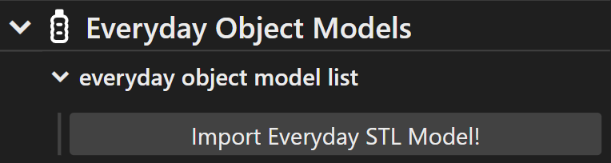
</div>

2. **Change the Print Parameters**
- Either import a preset by pressing `Import Preset` under the `Presets` folder or select the object and change the parameters shown for it in the left panel to get your desired results. Only the settings that apply to the object's type are shown. You can see descriptions of each of the parameters below under the **Print Parameters** section.
- If you don't want to have to set all the parameters again in the future, press `Export Preset` under the `Presets` folder so you can import them easily in the future.

<div align="center", style="margin: 20px;">
  <table style="border-width: 0px;">
    <tr>
      <td align="center">
        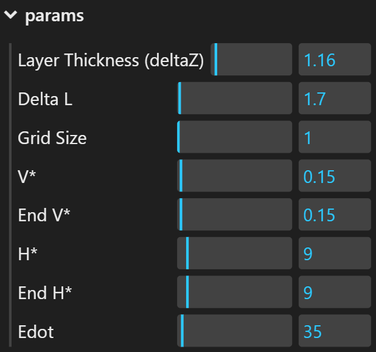<br>
        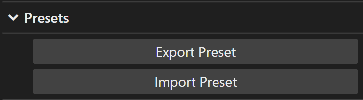
      </td>
      <td align="center">
        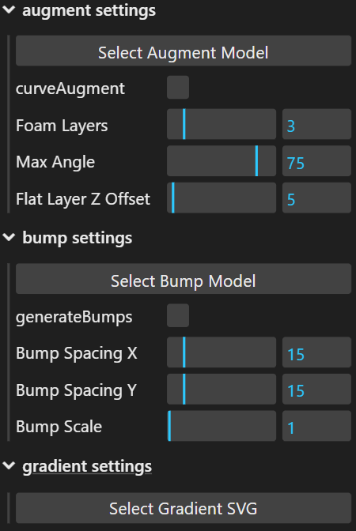
      </td>
    </tr>
  </table>
</div>

3. **Generate the Toolpath**
- For augmentation, select an `Augmentation` object and press `Select Foam Area` in its `Area Selection` folder. The camera moves to the top view of the model and a hint appears on the canvas. Draw with the left mouse button down to use lasso or rectangular selection to select part of the mesh (right-drag rotates the view while selecting; the hint's `Back to Top View` button returns to the top view). This may take a second, but after you wait you should see a visualization show up. If you change a parameter afterwards, the visualization is regenerated. Press `Esc` to stop selecting.
<div align="center", style="margin: 20px;">
    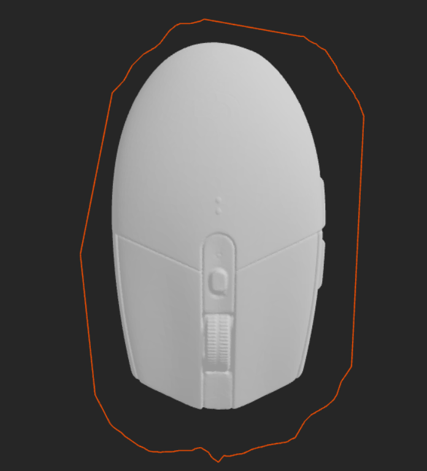
    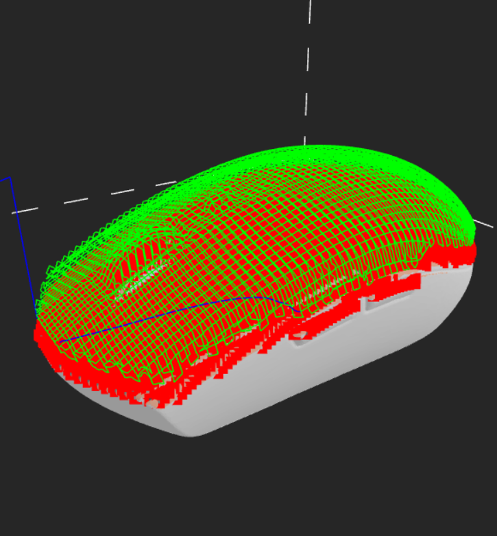
</div>

- For `Foam Print` and `Regular Print` objects, press `Slice Prints` at the bottom of the `Objects` list. It slices every such object on the plate into one G-code file: regular prints first, layer by layer, then the foam prints (see **How a Foam Print Is Printed** below). On its way from the purge line, from a boundary outline or from the regular prints to the foam, the head lifts straight up, crosses 10 mm above everything printed so far and comes straight down where printing starts; going from one foam print to another, it also stays 10 mm above the regular prints. When it is done the toolpath shows in the 3D view (see **Preview** below), each object's row says how many layers it has, and a summary under the button says what the file holds: objects, which slicer made the regular parts, about how long it prints, how much filament it uses (metres and grams, per tool), how many pauses it has, tools, height and file size.

<div align="center" style="margin: 20px;">
    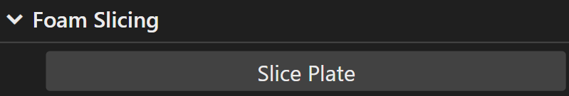<br>
    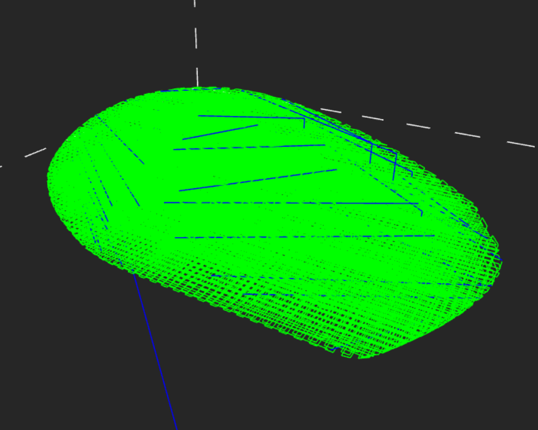
</div>

4. **Save the G-Code**
- When augmenting, hit the `Export Augmentation G-Code` button at the bottom of the `Objects` list (enabled once an area is selected) to download the gcode file for the foam printing toolpath.
- For foam and regular prints, press `Export Print G-Code` after `Slice Prints` to save the sliced file. Changing anything on the plate afterwards (moving a print, editing its settings, adding or deleting a print, changing a printer setting) marks the slice out of date: the summary says so and `Export Print G-Code` waits until you slice again.

<div align="center" style="margin: 20px;">
    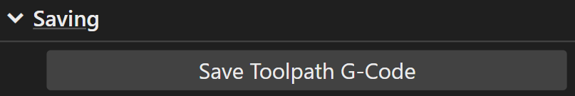
</div>

# Preview
A bar across the top of the 3D view controls the toolpath preview. It works on the selected Augmentation object's preview, or else on the sliced plate (until the plate changes).
- `Colour by`: `Feature` (foam, initial foam, sensing foam, walls, infill, solid infill, support, shell, and purge/brim/boundary), `Tool`, `Speed`, `V*`, `H*` or `Edot`. The legend under it says what the colours mean; click a feature or tool in the legend to hide it or show it again.
- The slider builds the print up one step at a time, in the order it prints: each step is one layer of one object (or the purge line, or a block of the purge tower). The label says which object and layer it is and at what height. While the slider is not at the end, the sliced prints' models are hidden so the layers inside them show; Augmentation objects stay.
- `Only this layer` shows the slider's step alone. `Travel` shows or hides the moves that do not extrude.

The time estimate follows the motion limits the G-code sets (speeds, acceleration, jerk); for a PrusaSlicer-sliced test part it came within 1 % of PrusaSlicer's own estimate. It does not count heating, homing, bed probing, or the time the printer waits for you at a pause, and it allows 20 s per tool change. Every exported file (prints and augmentations) also carries `M73` progress lines, so the printer shows how far along it is, the time left and, when there is a pause ahead, the time until it.

# How a Foam Print Is Printed
A `Foam Print` is not printed one whole layer at a time. Every layer of it has two parts:
- **A wall**: two lines of ordinary (non-foam) extrusion around the outline and around every hole, printed in 0.1 mm layers.
- **Foam** inside the wall, in layers of `Layer Thickness ΔZ`.

The foam nozzle rides H* thread diameters above the layer it prints, so it is always clear of its own layer, but it can come down beside something that already stands taller. The slicer therefore prints in sections and decides their order itself:
- **Walls first.** A wall is built before the foam inside it, up to the height the foam nozzle will be at, and the foam then fills it. A leaning wall still goes first as long as each wall line is held up by the one below it (up to about 60° from vertical). A steeper one rests on the foam under it and waits for that foam.
- **As much in one place as the nozzle allows.** A section stops where printing on would put material in the way of something that is still to be printed beside it: the nozzle as wide as it is at that height (the extruder's nozzle settings), or the print head (`Print Head Min/Max X/Y`, from one `Nozzle Length` above the tip). Pieces close together are therefore built up in turns, and pieces out of each other's reach are finished one after the other.
- **Foam is kept off the walls.** Foam is laid as a road of loops (coils) that is wider than the path the nozzle follows, so the path stops one coil radius short of the inner face of the wall. A part too narrow to keep its coils clear of the walls is still filled, to the edge of its foam area, and its coils land on the walls there. An `Augmentation` has no walls and is filled to the edge of the selected area.

The coil size comes from the lab's measurements of single foam roads (NinjaFlex 85A, 0.4 mm nozzle, H* 17.5 to 47.5): a loop is about `0.165 × H* + 1.0` mm across with a 0.4 mm thread, so about 2.0 mm at an H* of 6 and 2.5 mm at 9. For another thread diameter the size is scaled with it. Below an H* of 17.5 nothing was measured and the same line is carried on. With a gradient, the coils are sized by the largest H* along the edge of the foam, so foam with a lower H* stops a little short of the wall.

# Other Features

**Curved Augmentation**<br>
Instead of just generating a regular augmentation, you can also make one that has any top surface you want! With this you can flatten out the surface of any object so you can print regularly on it or you can print any shape you want onto the object your augmenting.

<div align="center" style="margin: 20px;">
    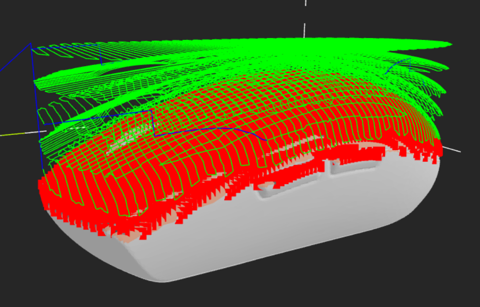
</div>


**Foam Gradients**<br>
You can make foam gradients on the x and y axes using an SVG file. This way, if you want to have different properties of the foam in different locations, you can do that.

<div align="center" style="margin: 20px;">
    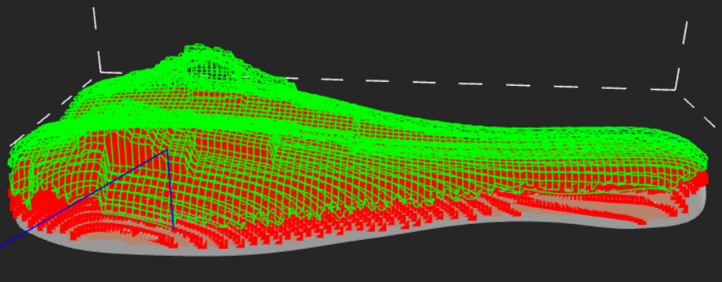
</div>


# Settings
Every control in the panel has a tooltip with the same description as below; hover over it (or focus it with the keyboard).
 - `Selection Settings` folder:
    - `Selection Tool`: Lasso (free draw); Box (rectangular draw)
    - `Selection Mode`: Visible Faces Only (only select the visible part of the mesh, i.e. front part); All Faces Touched / All Faces Inside (also selects non-visible mesh)
    - `Select Whole Model`: If checked, select the whole model
    - `Live Update`: If checked, live update the selected mesh and toolpath when lasso/box selection changes.
- `Printer Settings` folder:
    - `Bed Temperature (°C)`: Bed temperature.
    - `Bed Width X (mm)`: The max width of the print space.
    - `Bed Depth Y (mm)`: The max length of the print space.
    - `Build Height Z (mm)`: The max height of the print space.
    - `Filament Diameter (mm)`: The diameter of the filament being used.
    - `Print Head Min/Max X/Y (mm)`: The corners defining the dimensions of the print head's width and length. The coordinates (0, 0) are the position of the nozzle. This is used for collision detection.
    - `Multiple Toolheads`: If checked, the printer is a tool changer and each extruder is its own tool. If not checked, a change of extruder becomes a filament change.
    - `Purge Tower`: If checked, a purge tower is printed when the tool changes.
    - `Extruders` folder, one `Extruder N` folder per extruder:
        - `Nozzle Diameter (mm)`: The diameter of the extruder's nozzle.
        - `Nozzle Length (mm)`: The length of the nozzle from the tip to the base of the print head.
        - `Nozzle Tip Width (mm)`: Outer diameter of the flat tip of the nozzle, around the hole. About 1 mm on a Prusa XL.
        - `Nozzle Cone Height (mm)`: How far up from its tip the nozzle widens as a cone. 2 mm on a Prusa XL.
        - `Nozzle Cone Width (mm)`: Outer diameter of the nozzle at the top of its cone. 3.7 mm on a Prusa XL.
        - `Nozzle Body Width (mm)`: Outer diameter of the nozzle above its cone, up to the print head: across the corners of its hex. 8 mm on a Prusa XL.
        - The four nozzle widths and heights above describe the outside of the nozzle. A Foam Print uses them to decide how much it can print in one place before the nozzle would no longer fit beside it (see **How a Foam Print Is Printed**). The defaults are the Prusa Nextruder nozzle.
        - `Die Swell Factor`: The die swelling factor.
        - `Print Temperature (°C)`: Nozzle temperature while the extruder is printing.
        - `Idle Temperature (°C)`: Standby temperature while the extruder is parked.
        - `Travel Speed (mm/min)`: Print head speed for moves that do not extrude.
        - `Filament Density (g/cm³)`: Density of the filament in this extruder, for the filament weight in the slice summary (TPU is about 1.21, PLA 1.24, PETG 1.27).
- `Slicer Settings` folder:
    - `Fermat Spiral Infill`: If checked, infill patterns will be generated with fermat spirals. If not checked the slicer will generate a rectilinear pattern.
    - `Print Boundary`: if checked, the printer will print a boundary around the model. If selected when augmenting, the printer will also pause the print after the boundary is made, so you can place your object in the and then resume the augmentation.
    - `Purge Line`: If checked, the slicer will generate a purge line.
    - `Check Collisions`: If checked, the slicer will check whether the print head would hit something. Note that this will make slicing take longer.
        - When augmenting, it checks the head against the object and gives a suggested H* value to avoid collisions.
        - In `Slice Prints` (Foam Prints and Regular Prints), it follows the sliced toolpath in print order and checks the head against everything printed before each move: a foam print started beside a finished regular part, a piece of foam printed beside one that already stands taller, a move that crosses a part too low. What it finds is shown as a message and in the slice summary; the G-code can still be exported. The head is the box set in `Print Head` from one `Nozzle Length` above the nozzle tip upwards; the nozzle itself is not checked.
    - `Bed Leveling`: If checked, the printer will probe the bed for automatic leveling.
    - `PrusaSlicer Printer` *(desktop app with PrusaSlicer)*: the Prusa printer you print on, from PrusaSlicer's own profiles in the PrusaSlicer install. It starts as the Prusa XL Input Shaper with a 0.4 mm nozzle.
        - Picking one sets Printer Settings to match: bed size, print height, each extruder's nozzle, and `Multiple Toolheads` (on for an XL, off for an MK3S). Print Head, temperatures and the VTP settings stay as they are. The app warns when its own G-code (start, foam, purge, end) is not written for the printer (anything but an XL or an MK3S), or when Printer Settings has more extruders than the XL has tools.
        - PrusaSlicer slices Regular Prints with the profile's retraction, wipe and other printer settings. A multi-tool XL (2T, 5T) is sliced as the single-tool XL with the same nozzle, since the app makes the tool changes itself.
        - It also decides which print and filament profiles the objects can choose.
    - `Test Sweep (Dry Run)`: If checked, the printer will follow the toolpath without heating or extruding, allowing you to test if the print head will collide with your object safely.
# Print Parameters
These are in each everyday model's folder.
- `Foam Parameters` folder:
    - `Layer Thickness ΔZ (mm)`: How far apart each layer should be from one another.
    - `Line Spacing ΔL (mm)`: How far apart infill lines should be from one another.
    - `Top Line Spacing ΔL (mm)`: The line spacing at the top layer. The spacing changes evenly from Line Spacing at the bottom layer to this value at the top.
    - `Sampling Grid Size (mm)`: How far apart points should be sampled. Lowering this gives better accuracy but slower slicing times.
    - `Speed Ratio V*`: The ratio of print head speed to the speed the thread leaves the nozzle ($V_{movement} / V_{extrude}$). Values below 1 make the thread coil; at 1 and above it is laid down as a straight line or stretched.
    - `Gradient End V*`: When using a gradient, the V* value will get closer to Gradient End V* at darker sections on the gradient SVG. It will be closer to the regular V* value at lighter sections.
    - `Height Ratio H*`: The ratio of extrusion/nozzle height and thread diameter ($H_{nozzle} / D_{thread}$).
    - `Gradient End H*`: When using a gradient, the H* value will get closer to Gradient End H* at darker sections on the gradient SVG. It will be closer to the regular H* value at lighter sections.
    - `Extrusion Rate Edot (mm/min)`: The filament extrusion rate. Increasing this will increase both the extrusion speed and print head speed because they are in a ratio controlled by V*.
- `Initial Layer Parameters` folder:
    - Most parameters will be the same as in the Foam Parameters folder, but instead they will control the parameters for the initial few layers. Values that differ from the Foam Parameters are highlighted.
    - `Outward Offset (mm)`: How far offset outwards the initial layer should be. This is used to potentially create a scaffold around the model when augmenting.
    - `Initial Foam Layers`: How many foam layers should be printing using the initial parameters before switching to the regular parameters.
- `Sensing Parameters` folder:
    - The same parameters as in the Foam Parameters folder, used instead of them inside areas selected as sensing area. Values that differ from the Foam Parameters are highlighted.
- `Augmentation Settings` folder:
    - `Select Augment Model`: This button allows you to choose a model to augment your current model with. This allows you to customize the surface of your augment with any model. This will only work if the "Curved Augmentation" option is selected.
    - `Curved Augmentation`: If checked, the slicer will generate augmentations that curve into the selected augment model's shape. If checked but no model is selected, it will default to creating a flat surface.
    - `Foam Layers`: How many layers to generate for augmentations. The total number of layers generated will be Foam Layers + Initial Foam Layers under the Initial Layer Parameters folder.
    - `Max Surface Angle (°)`: The max angle to generate augmentations on. This allows you to only augment on flatter surfaces so you can print lower to the model and get better results.
    - `Flat Layer Z Offset (mm)`: This controls how far above the model the default flat layer is when the Curved Augmentation feature is enabled. This only has any effect when Curved Augmentation is enabled but no augment model has been selected.
    - `Additional Curve Layers`: How many extra layers of the given curvature should be printed after the path reaches the desired curvature. For example, if you are flattening out a surface, setting this to 3 will print 3 additional flat layers after the path is curved to be totally flat.
- `Bump Settings` folder:
    - `Select Bump Model`: This button lets you select a model to generate across the surface of your augmentation to improve grip.
    - `Generate Bumps`: If checked, generates bumps on the surface of any augmentation you generate.
    - `Bump Spacing X (mm)`: How far apart the center of the bumps are on the x axis.
    - `Bump Spacing Y (mm)`: How far apart the center of the bumps are on the y axis.
    - `Bump Scale`: The scale of the bump model.
- `Gradient Settings` folder:
    - `Select Gradient SVG`: Allows you to select an svg file to define a gradient of foam properties. The color of the svg corresponds to a percentage, with black being 100% and white being 0%. The higher the percentage, the closer the parameters are to Gradient End H* and Gradient End V* rather than H* and V*. Currently, it's only possible to make gradients across the x and y axis, not the z axis. 
- `Area Selection` folder:
    - `Select Foam Area`: Arms selection of the area that gets foam. A hint on the canvas explains how to draw it; press `Esc` to stop selecting.
    - `Select Sensing Area`: Arms selection of a sensing area inside the foam area. It is printed with the Sensing Parameters.
    - `Add Sensing Box (20 mm)`: Adds a box on top of the model that you can drag across the surface; the triangles inside it become sensing area.

# Regular Print Settings
These are in the folder of each `Regular Print` object. Settings marked *(PrusaSlicer)* are only used when the desktop app slices with PrusaSlicer (see **Desktop App** below); elsewhere they are greyed out and the built-in slicer ignores them.
- `Layer Height (mm)`: Thickness of each layer.
- `First Layer Height (mm)` *(PrusaSlicer)*: Thickness of the first layer. A thicker first layer sticks better. It cannot be more than the nozzle diameter.
- `Wall Loops`: How many loops are printed around the outline of every layer.
- `Top / Bottom Layers`: How many solid layers close every top and bottom surface.
- `Infill Density (%)`: How much of the inside is filled.
- `Infill Pattern` *(PrusaSlicer)*: Pattern of the sparse infill (Grid, Gyroid, Cubic, Lightning, ...). PrusaSlicer cannot fill a solid part with most of them, so at 100 % the inside is filled with straight lines instead.
- `Supports` *(PrusaSlicer)*: None, Build Plate Only (supports only stand on the bed, never on the part) or Everywhere.
- `Support Style` *(PrusaSlicer)*: Grid, Snug or Organic (tree) supports. Only used while Supports is on.
- `Overhang Threshold (°)` *(PrusaSlicer)*: Surfaces flatter than this angle get support; 0 lets PrusaSlicer decide. Only used while Supports is on.
- `Brim Width (mm)` *(PrusaSlicer)*: Width of a flat ring around the part's first layer, to stop corners lifting. 0 prints none.
- `Extruder`: Which extruder prints the part.
- `Print Speed (mm/min)`: Speed of the print head while extruding. With PrusaSlicer, every kind of line is printed at this speed (walls, infill, bridges, supports, gap fill); travel moves use the extruder's travel speed.
- `First Layer Speed (mm/min)` *(PrusaSlicer)*: Speed of every move on the first layer.
- `Print Profile` *(PrusaSlicer)*: Prusa's print profile to start from (speeds with `Use Profile Speeds`, accelerations, seams, bridging, ...). The settings above win where they overlap. Only the profiles that suit the `PrusaSlicer Printer` are offered.
- `Filament Profile` *(PrusaSlicer)*: Prusa's filament profile (cooling, fan, retraction, pressure advance). Temperatures still come from the extruder's settings.
- `Use Profile Speeds` *(PrusaSlicer)*: Use the print speeds of your PrusaSlicer profile (or PrusaSlicer's defaults) instead of Print Speed and First Layer Speed. Travel moves still use the extruder's travel speed.

# Presets
A preset is a plain text file with one `key value` pair per line. It stores every setting above, every extruder, and the parameters of one everyday model (the selected one, or the first one if none is selected), including its Regular Print Settings (as `regular.…` lines). It does not store what type an object is. Files start with a `presetVersion` line; older files, with or without it, still import.

When a preset is imported, every value is checked first (type, range, allowed options). If any line is invalid the whole file is rejected and nothing changes. Model parameters are applied to the selected everyday model, or to all everyday models if none is selected; if no everyday model is loaded yet, they are applied to the models you import afterwards.


> [!IMPORTANT]  
> Known bugs:
> - Fermat spiral infill overlaps for certain geometries.
> - Augmentation toolpaths are slightly bumpy.
> - Rectilinear paths go over holes in models and for certain geometries print outside of the model.
# Desktop App (PrusaSlicer)

The same app also runs as a desktop app (Electron), which can slice **Regular Print** objects with [PrusaSlicer](https://www.prusa3d.com/page/prusaslicer_424/) instead of the built-in slicer. That brings in PrusaSlicer's supports, bridging, retraction, cooling and Arachne walls.

1. Install PrusaSlicer. The app looks for it in the usual install folder (on Windows, `C:\Program Files\Prusa3D\PrusaSlicer\prusa-slicer-console.exe`). If it is somewhere else, use **Slicer → Locate PrusaSlicer…** or set the `PRUSA_SLICER_PATH` environment variable.
2. Optionally, export a config from PrusaSlicer (**File → Export → Export Config**) and choose it under **Slicer → Choose PrusaSlicer Profile…**. Everything it sets is used, except the settings the app controls: each object's own Regular Print Settings (layer and first-layer height, walls, infill density and pattern, solid layers, supports, brim and, unless `Use Profile Speeds` is checked, the print and first-layer speeds), the machine size, nozzle and filament, and the start/end G-code, skirt and wipe tower (the app's own start/end G-code, purge line and purge tower are used instead).
3. Install the app's dependencies once, then start it:

```bash
npm install
```

```bash
npm run desktop
```

`npm run desktop` makes a production build of the page first. `npm run desktop:dev` starts with a development build instead (faster to build, with source maps).

Changing the PrusaSlicer program or profile from the **Slicer** menu marks a sliced plate out of date, like any other change to the plate. A post-processing script in a profile is never run: the app reads PrusaSlicer's G-code back as it wrote it.

The app reads Prusa's own printer, print and filament profiles from the PrusaSlicer install (`resources/profiles/PrusaResearch.ini`); it does not ship them. They are applied in this order, each winning over the one before: the `PrusaSlicer Printer` and the object's `Print Profile` and `Filament Profile`, then your own config from step 2, then the app's own settings.

PrusaSlicer's accelerations, jerk and pressure advance (from the print and filament profiles) are kept for the regular parts. Before any move the app makes itself (foam, shells, purge), it sets its own back: pressure advance off (`M572 S0` on the XL, `M900 K0` on the MK3S), 1000 mm/s² acceleration and 8 mm/s jerk. When PrusaSlicer's moves carry on after the app's own (after a purge tower layer, say), the values PrusaSlicer last set for that tool are written again. A foam thread is laid at a fixed ratio V* to the head speed, and pressure advance would push extra filament out whenever the head speeds up. The start G-code now also turns pressure advance off: `M572 S0` on the XL, instead of the MK3-style `M900` lines it wrote before, and `M900 K0` on the MK3S, instead of `M900 K0.05` and `K30`, which turned it on.

Without PrusaSlicer, or in the web version, Regular Print objects are sliced with the built-in slicer as before. Foam and augmentation slicing is unchanged; foam that follows a PrusaSlicer part is printed with the part cooling fan off, as it is on its own.

PrusaSlicer is a separate program under the AGPL-3.0 licence. The app only runs it; it is not included.

# Running and Developing

The app is a web page built with webpack. With [Node.js](https://nodejs.org/) installed, install the dependencies once:

```bash
npm install
```

Then, from the project folder:

- `npm start` builds the page for development and opens it in the browser, rebuilding on every change.
- `npm run build` makes the production build in `dist/`.
- `npm test` runs the tests, and `npm run typecheck` checks the types of the app and the tests.
- `npm run desktop` builds the page and starts the desktop app (see above).

# Tests

`npm test` runs every test file once; the whole suite takes a few seconds. The tests run in Node with [Vitest](https://vitest.dev/): no browser, no PrusaSlicer and no printer are needed, so they check the toolpaths and G-code the app works out, not how a print comes out. Each test file sits beside the code it tests, and the pushes to `main` and the pull requests are checked with `npm run typecheck`, `npm test` and `npm run build`.

- `npx vitest run src/visualizer/toolpath/coilModel.test.ts` runs one file.
- `npx vitest run --reporter=verbose` lists every test by name.
- A code in a test's name, such as `(G5)` or `(S9)`, is the entry in [ISSUES.md](ISSUES.md) the test was written for.

The tables say what each test file is there to keep working. A file that fails points at the part of the app in its row. All paths are under `src/visualizer/` unless they start with `electron/`.

**Slicing foam** (Foam Prints and Augmentations)

| Test file | What it supports | What it checks |
|---|---|---|
| `utils/TreeSlicer.test.ts` | Cutting a model into layers, and the order a Foam Print is printed in (see **How a Foam Print Is Printed**) | Closed outlines with their holes from a mesh; insetting an outline, including ones that split or leave slivers; which piece of a layer sits on which; when a wall rests on foam and when it stands on the wall below; the shape of the nozzle; how much is printed in one place before the nozzle or head would be in the way, for one model and for several; outlines of a selected area |
| `toolpath/generateFoamToolpath.test.ts` | The foam toolpath of an Augmentation and of `Slice Prints`, from model to path | Purge line and purge tower; initial layers and their offset; curved augmentation and its extra flat layers; bumps; the line spacing ramp; sensing areas; the boundary outline; crossing the bed above the purge line, the boundaries and earlier parts on the way to the first layer; foam kept a coil radius from the walls; the object, layer and feature tags the preview uses; sampling the selected area |
| `toolpath/coilModel.test.ts` | The size of foam coils, used for how wide foam is and how far it stays from walls | The lab's measurements and the lines fitted to them; coil size against the AugPrint paper; the wall inset; loop overlap and spacing against V* |
| `toolpath/layerHeights.test.ts` | The height of the nozzle at every foam point, and layers draped over a surface (`Curved Augmentation`) | Finite heights for every layer count; the surface height under a point; layers that never step down |
| `toolpath/collision.test.ts` | `Check Collisions` when augmenting | The H* offset needed for the print head to clear the object |
| `toolpath/printCollision.test.ts` | `Check Collisions` in `Slice Prints` | Finding the moves where the print head would hit something printed earlier, and the message that says so |
| `loaders/modelLoader.test.ts` | Importing models, `Load Example`, gradients and copies | Reading STL files and refusing broken ones; the built-in example model; sampling the top surface of a mesh; looking colours up in a gradient image; the names of copies |

**Regular Prints**

| Test file | What it supports | What it checks |
|---|---|---|
| `toolpath/regularSlicer.test.ts` | The built-in slicer for `Regular Print` objects | Layers, walls, top and bottom layers, infill density, holes, stepped parts, several parts at once; refusing settings that cannot be printed; the G-code that comes out |
| `toolpath/prusaSlicer.test.ts` | Slicing Regular Prints with PrusaSlicer in the desktop app | What is sent to PrusaSlicer, with which profiles; falling back to the built-in slicer; where the tool changes between two groups of parts |
| `toolpath/prusaGcode.test.ts` | Reading PrusaSlicer's G-code back into the app's own file | Parsing moves and object labels; the config written for PrusaSlicer and the checks on its options; keeping its acceleration and pressure advance |
| `toolpath/prusaProfiles.test.ts` | `PrusaSlicer Printer`, `Print Profile` and `Filament Profile` | Reading Prusa's profile bundle; which printers and profiles are offered; the bed, height and nozzles taken from a printer profile |
| `electron/requestChecks.test.js` | The desktop app's guard on what the page may ask it to run | Checking a slicing request and its settings; removing settings that would run a program; which page may talk to it |

**G-code, the sliced plate and the preview**

| Test file | What it supports | What it checks |
|---|---|---|
| `toolpath/buildGcode.test.ts` | Writing the G-code file | Tool changes and heaters across several models; refusing a toolpath outside the machine; purge positions; the material swap for initial layers; start G-code and feed rates; the part cooling fan; `Test Sweep (Dry Run)` |
| `toolpath/gcodeActions.test.ts` | The `Slice Prints` and export buttons | The approach to the start of a print, and from one foam print to another, above the regular prints; reporting head collisions after slicing; exporting only while the slice is up to date |
| `toolpath/plateSlice.test.ts` | The slice summary, and marking a slice out of date | Layer counts per object; time and filament per tool; noticing every change to the plate |
| `toolpath/printEstimate.test.ts` | The time and filament estimate, and the `M73` progress lines | Move times with acceleration and jerk; filament per tool; pauses and tool changes; progress that only counts up |
| `toolpath/toolpathPreview.test.ts` | The **Preview** bar | The steps of the slider; `Colour by` and its legend; the speeds shown |

**Objects, placement and the panel**

| Test file | What it supports | What it checks |
|---|---|---|
| `utils/arrange.test.ts` | `Arrange`, where a new object is put, and the warning about objects in the print head's reach | Finding free space; packing objects clear of each other and of fixed ones; objects that do not fit |
| `utils/geometryUtils.test.ts` | Area selection | Convex hulls and counting crossings of a ray |
| `gui/placement.test.ts` | `Snap Model to Plate`, `Lay on Face`, and the print head's reach used by `Arrange` and placement | A turned model resting its lowest point on the bed; the reach growing by the boundary outline when `Print Boundary` is on |
| `gui/modelActions.test.ts` | Deleting and moving an object | Everything that belongs to an object going with it |
| `gui/objectSummary.test.ts` | The status text in the `Objects` list and the slice summary | What each object still needs; sizes, durations and the estimate in words |
| `gui/presetFormat.test.ts` | `Export Preset` and `Import Preset` | Every setting written and read back; older preset files; refusing a file with an invalid line |
| `gui/downloadName.test.ts` | The names of saved G-code files | The date and time stamp, and names that are safe as file names |
| `gui/keyTarget.test.ts` | Keyboard shortcuts | Shortcuts and `Esc` not firing while a field is being typed in |
| `interactions/pointerToNdc.test.ts` | Selecting and moving objects with the pointer | Turning a pointer position into a position in the 3D view |

When a test file is added, removed or changes what it covers, change its row here.
