🧽 The foam augmentation slicer web app .

# How to use
1. **Import the Model**
The window has three parts: the settings panel on the left, the 3D view in the middle and the `Objects` list on the right.

Press `+ Add` in the `Objects` list and pick what the model is:
- `Augmentation`: an existing object placed on the bed. It is not printed; foam is printed onto the area you select on it.
- `Foam Print`: the whole model is printed as foam.
- `Regular Print`: the model is printed as an ordinary solid plastic part.

Then select an `stl` file. You can also drop STL files on the window (they come in as `Augmentation`), or press `Load Example` on the start card to add a small built-in model. The app puts the model in the free space nearest the middle of the print bed (see below).

Every object shows in the `Objects` list with its type. Click an object there (or in the 3D view) to select it: it gets an outline in the 3D view, and the left panel shows that object's settings under `Selected Object`. The `Type` control at the top of its settings changes what the object is, and you can move, rotate and scale it in its `Transform` folder.

Placing objects on the bed:
- A new object (imported, dropped, or a copy) is put in the free space nearest the middle of the bed (a copy: nearest the original), clear of the other objects.
- `Arrange` at the top of the `Objects` list (shortcut `A`) packs the Foam and Regular Prints around the middle of the bed, 6 mm apart and clear of the purge line and purge tower. Augmentation objects stay where they are: they are real objects on the bed. Anything taller than the nozzle is also kept out of the print head's reach around a Foam Print or an Augmentation (Printer Settings › Print Head Min/Max X/Y), so the head cannot hit it while it prints foam.
- `⧉` on an object's row (shortcut `Ctrl+D`) adds a copy with the same type, orientation and settings. A copy of an Augmentation starts without a foam area.
- In the `Transform` folder, `Lay on Face` (shortcut `F`) waits for a click on the object, then turns it so the clicked face rests on the bed (`Esc` cancels). `Snap Model to Plate` rests the object's lowest point on the bed, however it is rotated.
- When a file is sliced or exported, the app warns by name about any object that stands in the print head's reach while foam prints next to it.
<div align="center" style="margin: 20px;">
    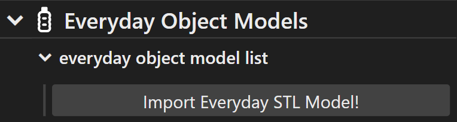
</div>

2. **Change the Print Parameters**
- Either import a preset by pressing `Import Preset` under the `Presets` folder or select the object and change the parameters shown for it in the left panel to get your desired results. Only the settings that apply to the object's type are shown. You can see descriptions of each of the parameters below under the **Print Parameters** section.
- If you don't want to have to set all the parameters again in the future, press `Export Preset` under the `Presets` folder so you can import them easily in the future.

<div align="center", style="margin: 20px;">
  <table style="border-width: 0px;">
    <tr>
      <td align="center">
        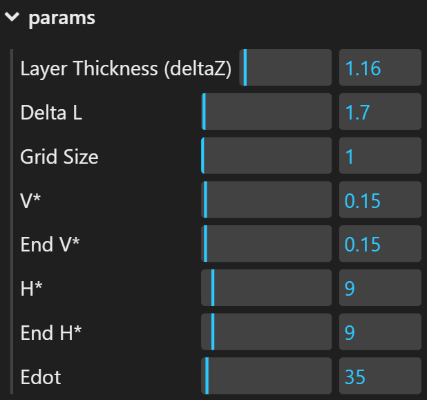<br>
        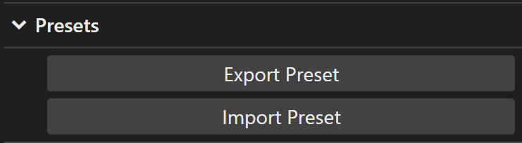
      </td>
      <td align="center">
        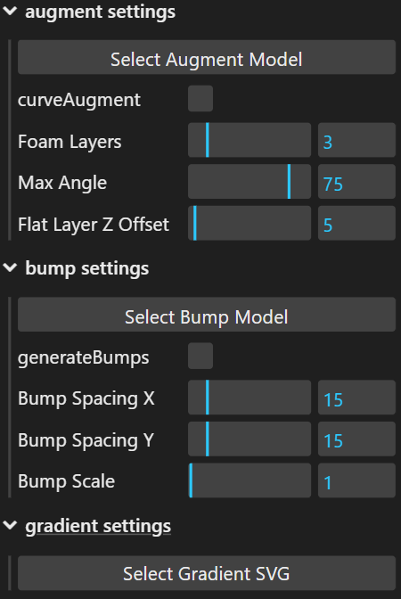
      </td>
    </tr>
  </table>
</div>

3. **Generate the Toolpath**
- For augmentation, select an `Augmentation` object and press `Select Foam Area` in its `Area Selection` folder. The camera moves to the top view of the model and a hint appears on the canvas. Draw with the left mouse button down to use lasso or rectangular selection to select part of the mesh (right-drag rotates the view while selecting; the hint's `Back to Top View` button returns to the top view). This may take a second, but after you wait you should see a visualization show up. If you change a parameter afterwards, the visualization is regenerated. Press `Esc` to stop selecting.
<div align="center", style="margin: 20px;">
    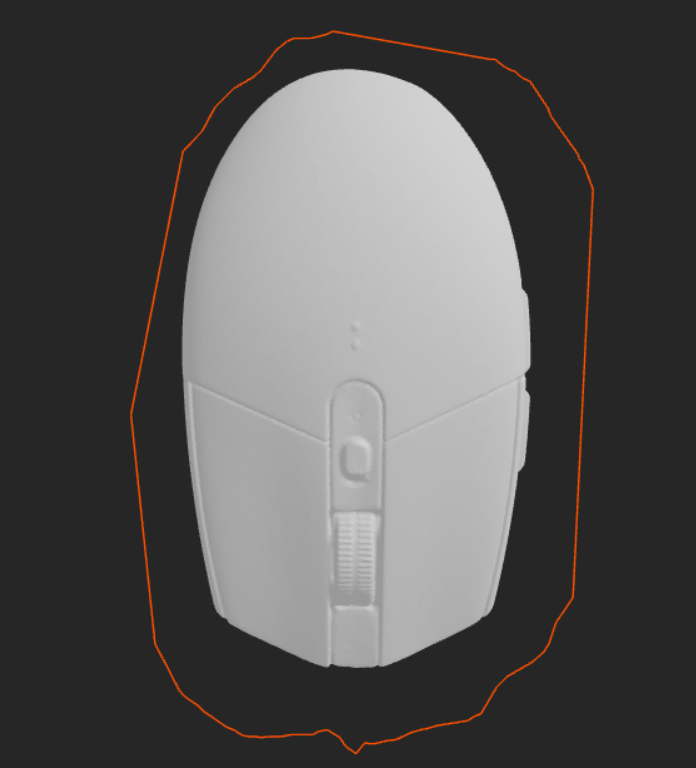
    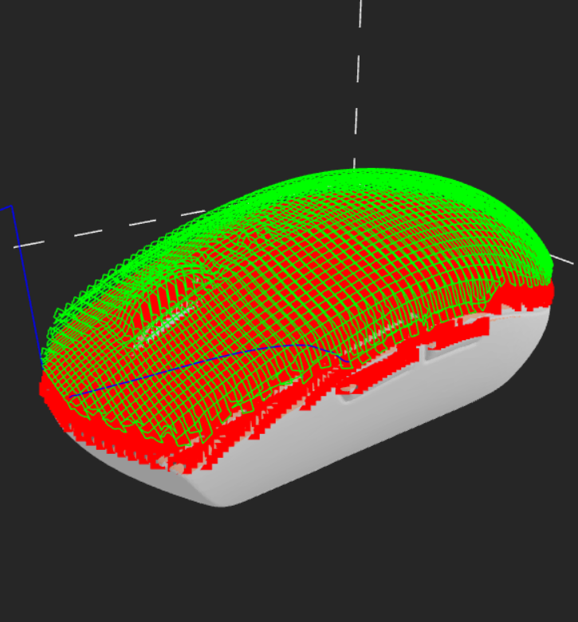
</div>

- For `Foam Print` and `Regular Print` objects, press `Slice Prints` at the bottom of the `Objects` list. It slices every such object on the plate into one G-code file: regular prints first, layer by layer, then the foam prints. When it is done the toolpath shows in the 3D view (see **Preview** below), each object's row says how many layers it has, and a summary under the button says what the file holds: objects, which slicer made the regular parts, about how long it prints, how much filament it uses (metres and grams, per tool), how many pauses it has, tools, height and file size.

<div align="center" style="margin: 20px;">
    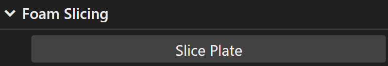<br>
    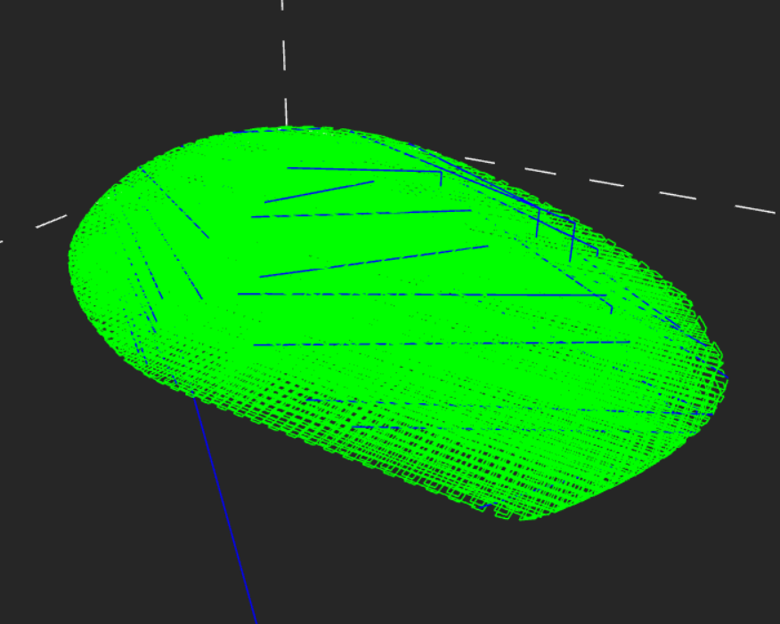
</div>

4. **Save the G-Code**
- When augmenting, hit the `Export Augmentation G-Code` button at the bottom of the `Objects` list (enabled once an area is selected) to download the gcode file for the foam printing toolpath.
- For foam and regular prints, press `Export Print G-Code` after `Slice Prints` to save the sliced file. Changing anything on the plate afterwards (moving a print, editing its settings, adding or deleting a print, changing a printer setting) marks the slice out of date: the summary says so and `Export Print G-Code` waits until you slice again.

<div align="center" style="margin: 20px;">
    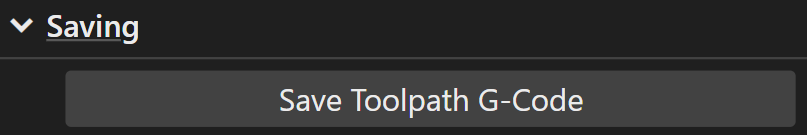
</div>

# Preview
A bar across the top of the 3D view controls the toolpath preview. It works on the selected Augmentation object's preview, or else on the sliced plate (until the plate changes).
- `Colour by`: `Feature` (foam, initial foam, sensing foam, walls, infill, solid infill, support, shell, and purge/brim/boundary), `Tool`, `Speed`, `V*`, `H*` or `Edot`. The legend under it says what the colours mean; click a feature or tool in the legend to hide it or show it again.
- The slider builds the print up one step at a time, in the order it prints: each step is one layer of one object (or the purge line, or a block of the purge tower). The label says which object and layer it is and at what height. While the slider is not at the end, the sliced prints' models are hidden so the layers inside them show; Augmentation objects stay.
- `Only this layer` shows the slider's step alone. `Travel` shows or hides the moves that do not extrude.

The time estimate follows the motion limits the G-code sets (speeds, acceleration, jerk); for a PrusaSlicer-sliced test part it came within 1 % of PrusaSlicer's own estimate. It does not count heating, homing, bed probing, or the time the printer waits for you at a pause, and it allows 20 s per tool change. Every exported file (prints and augmentations) also carries `M73` progress lines, so the printer shows how far along it is, the time left and, when there is a pause ahead, the time until it.

# Other Features

**Curved Augmentation**<br>
Instead of just generating a regular augmentation, you can also make one that has any top surface you want! With this you can flatten out the surface of any object so you can print regularly on it or you can print any shape you want onto the object your augmenting.

<div align="center" style="margin: 20px;">
    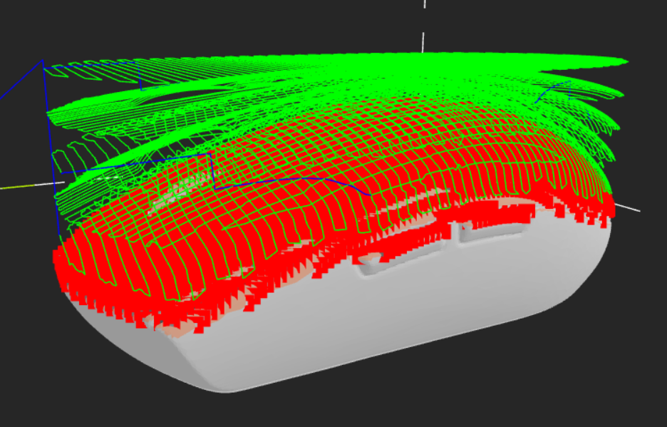
</div>


**Foam Gradients**<br>
You can make foam gradients on the x and y axes using an SVG file. This way, if you want to have different properties of the foam in different locations, you can do that.

<div align="center" style="margin: 20px;">
    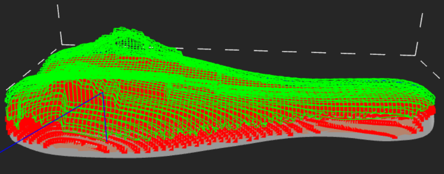
</div>


# Settings
Every control in the panel has a tooltip with the same description as below; hover over it (or focus it with the keyboard).
 - `Selection Settings` folder:
    - `Selection Tool`: Lasso (free draw); Box (rectangular draw)
    - `Selection Mode`: Visible Faces Only (only select the visible part of the mesh, i.e. front part); All Faces Touched / All Faces Inside (also selects non-visible mesh)
    - `Select Whole Model`: If checked, select the whole model
    - `Live Update`: If checked, live update the selected mesh and toolpath when lasso/box selection changes.
    - `Show Selection Wireframe`: If checked, show the selected mesh's wireframe.
- `Printer Settings` folder:
    - `Bed Temperature (°C)`: Bed temperature.
    - `Bed Width X (mm)`: The max width of the print space.
    - `Bed Depth Y (mm)`: The max length of the print space.
    - `Build Height Z (mm)`: The max height of the print space.
    - `Filament Diameter (mm)`: The diameter of the filament being used.
    - `Print Head Min/Max X/Y (mm)`: The corners defining the dimensions of the print head's width and length. The coordinates (0, 0) are the position of the nozzle. This is used for collision detection.
    - `Multiple Toolheads`: If checked, the printer is a tool changer and each extruder is its own tool. If not checked, a change of extruder becomes a filament change.
    - `Purge Tower`: If checked, a purge tower is printed when the tool changes.
    - `Extruders` folder, one `Extruder N` folder per extruder:
        - `Nozzle Diameter (mm)`: The diameter of the extruder's nozzle.
        - `Nozzle Length (mm)`: The length of the nozzle from the tip to the base of the print head.
        - `Die Swell Factor`: The die swelling factor.
        - `Print Temperature (°C)`: Nozzle temperature while the extruder is printing.
        - `Idle Temperature (°C)`: Standby temperature while the extruder is parked.
        - `Travel Speed (mm/min)`: Print head speed for moves that do not extrude.
        - `Filament Density (g/cm³)`: Density of the filament in this extruder, for the filament weight in the slice summary (TPU is about 1.21, PLA 1.24, PETG 1.27).
- `Slicer Settings` folder:
    - `Fermat Spiral Infill`: If checked, infill patterns will be generated with fermat spirals. If not checked the slicer will generate a rectilinear pattern.
    - `Print Boundary`: if checked, the printer will print a boundary around the model. If selected when augmenting, the printer will also pause the print after the boundary is made, so you can place your object in the and then resume the augmentation.
    - `Purge Line`: If checked, the slicer will generate a purge line.
    - `Check Collisions`: If checked, the slicer will check for collisions when augmenting and give a suggested H* value to avoid collisions. Note that this will make slicing take longer.
    - `Bed Leveling`: If checked, the printer will probe the bed for automatic leveling.
    - `PrusaSlicer Printer` *(desktop app with PrusaSlicer)*: Prusa's printer profile PrusaSlicer slices Regular Prints with (retraction, wipe and other printer settings), read from the PrusaSlicer install. It starts as the Prusa XL Input Shaper with a 0.4 mm nozzle. It also decides which print and filament profiles the objects can choose.
    - `Test Sweep (Dry Run)`: If checked, the printer will follow the toolpath without heating or extruding, allowing you to test if the print head will collide with your object safely.
# Print Parameters
These are in each everyday model's folder.
- `Foam Parameters` folder:
    - `Layer Thickness ΔZ (mm)`: How far apart each layer should be from one another.
    - `Line Spacing ΔL (mm)`: How far apart infill lines should be from one another.
    - `Top Line Spacing ΔL (mm)`: The line spacing at the top layer. The spacing changes evenly from Line Spacing at the bottom layer to this value at the top.
    - `Sampling Grid Size (mm)`: How far apart points should be sampled. Lowering this gives better accuracy but slower slicing times.
    - `Speed Ratio V*`: The ratio of print head speed to the speed the thread leaves the nozzle ($V_{movement} / V_{extrude}$). Values below 1 make the thread coil; at 1 and above it is laid down as a straight line or stretched.
    - `Gradient End V*`: When using a gradient, the V* value will get closer to Gradient End V* at darker sections on the gradient SVG. It will be closer to the regular V* value at lighter sections.
    - `Height Ratio H*`: The ratio of extrusion/nozzle height and thread diameter ($H_{nozzle} / D_{thread}$).
    - `Gradient End H*`: When using a gradient, the H* value will get closer to Gradient End H* at darker sections on the gradient SVG. It will be closer to the regular H* value at lighter sections.
    - `Extrusion Rate Edot (mm/min)`: The filament extrusion rate. Increasing this will increase both the extrusion speed and print head speed because they are in a ratio controlled by V*.
- `Initial Layer Parameters` folder:
    - Most parameters will be the same as in the Foam Parameters folder, but instead they will control the parameters for the initial few layers. Values that differ from the Foam Parameters are highlighted.
    - `Outward Offset (mm)`: How far offset outwards the initial layer should be. This is used to potentially create a scaffold around the model when augmenting.
    - `Initial Foam Layers`: How many foam layers should be printing using the initial parameters before switching to the regular parameters.
- `Sensing Parameters` folder:
    - The same parameters as in the Foam Parameters folder, used instead of them inside areas selected as sensing area. Values that differ from the Foam Parameters are highlighted.
- `Augmentation Settings` folder:
    - `Select Augment Model`: This button allows you to choose a model to augment your current model with. This allows you to customize the surface of your augment with any model. This will only work if the "Curved Augmentation" option is selected.
    - `Curved Augmentation`: If checked, the slicer will generate augmentations that curve into the selected augment model's shape. If checked but no model is selected, it will default to creating a flat surface.
    - `Foam Layers`: How many layers to generate for augmentations. The total number of layers generated will be Foam Layers + Initial Foam Layers under the Initial Layer Parameters folder.
    - `Max Surface Angle (°)`: The max angle to generate augmentations on. This allows you to only augment on flatter surfaces so you can print lower to the model and get better results.
    - `Flat Layer Z Offset (mm)`: This controls how far above the model the default flat layer is when the Curved Augmentation feature is enabled. This only has any effect when Curved Augmentation is enabled but no augment model has been selected.
    - `Additional Curve Layers`: How many extra layers of the given curvature should be printed after the path reaches the desired curvature. For example, if you are flattening out a surface, setting this to 3 will print 3 additional flat layers after the path is curved to be totally flat.
- `Bump Settings` folder:
    - `Select Bump Model`: This button lets you select a model to generate across the surface of your augmentation to improve grip.
    - `Generate Bumps`: If checked, generates bumps on the surface of any augmentation you generate.
    - `Bump Spacing X (mm)`: How far apart the center of the bumps are on the x axis.
    - `Bump Spacing Y (mm)`: How far apart the center of the bumps are on the y axis.
    - `Bump Scale`: The scale of the bump model.
- `Gradient Settings` folder:
    - `Select Gradient SVG`: Allows you to select an svg file to define a gradient of foam properties. The color of the svg corresponds to a percentage, with black being 100% and white being 0%. The higher the percentage, the closer the parameters are to Gradient End H* and Gradient End V* rather than H* and V*. Currently, it's only possible to make gradients across the x and y axis, not the z axis. 
- `Area Selection` folder:
    - `Select Foam Area`: Arms selection of the area that gets foam. A hint on the canvas explains how to draw it; press `Esc` to stop selecting.
    - `Select Sensing Area`: Arms selection of a sensing area inside the foam area. It is printed with the Sensing Parameters.
    - `Add Sensing Box (20 mm)`: Adds a box on top of the model that you can drag across the surface; the triangles inside it become sensing area.

# Regular Print Settings
These are in the folder of each `Regular Print` object. Settings marked *(PrusaSlicer)* are only used when the desktop app slices with PrusaSlicer (see **Desktop App** below); elsewhere they are greyed out and the built-in slicer ignores them.
- `Layer Height (mm)`: Thickness of each layer.
- `First Layer Height (mm)` *(PrusaSlicer)*: Thickness of the first layer. A thicker first layer sticks better. It cannot be more than the nozzle diameter.
- `Wall Loops`: How many loops are printed around the outline of every layer.
- `Top / Bottom Layers`: How many solid layers close every top and bottom surface.
- `Infill Density (%)`: How much of the inside is filled.
- `Infill Pattern` *(PrusaSlicer)*: Pattern of the sparse infill (Grid, Gyroid, Cubic, Lightning, ...). PrusaSlicer cannot fill a solid part with most of them, so at 100 % the inside is filled with straight lines instead.
- `Supports` *(PrusaSlicer)*: None, Build Plate Only (supports only stand on the bed, never on the part) or Everywhere.
- `Support Style` *(PrusaSlicer)*: Grid, Snug or Organic (tree) supports. Only used while Supports is on.
- `Overhang Threshold (°)` *(PrusaSlicer)*: Surfaces flatter than this angle get support; 0 lets PrusaSlicer decide. Only used while Supports is on.
- `Brim Width (mm)` *(PrusaSlicer)*: Width of a flat ring around the part's first layer, to stop corners lifting. 0 prints none.
- `Extruder`: Which extruder prints the part.
- `Print Speed (mm/min)`: Speed of the print head while extruding.
- `First Layer Speed (mm/min)` *(PrusaSlicer)*: Speed of every move on the first layer.
- `Print Profile` *(PrusaSlicer)*: Prusa's print profile to start from (speeds with `Use Profile Speeds`, accelerations, seams, bridging, ...). The settings above win where they overlap. Only the profiles that suit the `PrusaSlicer Printer` are offered.
- `Filament Profile` *(PrusaSlicer)*: Prusa's filament profile (cooling, fan, retraction, pressure advance). Temperatures still come from the extruder's settings.
- `Use Profile Speeds` *(PrusaSlicer)*: Use the speeds of your PrusaSlicer profile (or PrusaSlicer's defaults) instead of Print Speed and First Layer Speed.

# Presets
A preset is a plain text file with one `key value` pair per line. It stores every setting above, every extruder, and the parameters of one everyday model (the selected one, or the first one if none is selected), including its Regular Print Settings (as `regular.…` lines). It does not store what type an object is. Files start with a `presetVersion` line; older files, with or without it, still import.

When a preset is imported, every value is checked first (type, range, allowed options). If any line is invalid the whole file is rejected and nothing changes. Model parameters are applied to the selected everyday model, or to all everyday models if none is selected; if no everyday model is loaded yet, they are applied to the models you import afterwards.


> [!IMPORTANT]  
> Known bugs:
> - Fermat spiral infill overlaps for certain geometries.
> - Augmentation toolpaths are slightly bumpy.
> - Rectilinear paths go over holes in models and for certain geometries print outside of the model.
# Desktop App (PrusaSlicer)

The same app also runs as a desktop app (Electron), which can slice **Regular Print** objects with [PrusaSlicer](https://www.prusa3d.com/page/prusaslicer_424/) instead of the built-in slicer. That brings in PrusaSlicer's supports, bridging, retraction, cooling and Arachne walls.

1. Install PrusaSlicer. The app looks for it in the usual install folder (on Windows, `C:\Program Files\Prusa3D\PrusaSlicer\prusa-slicer-console.exe`). If it is somewhere else, use **Slicer → Locate PrusaSlicer…** or set the `PRUSA_SLICER_PATH` environment variable.
2. Optionally, export a config from PrusaSlicer (**File → Export → Export Config**) and choose it under **Slicer → Choose PrusaSlicer Profile…**. Everything it sets is used, except the settings the app controls: each object's own Regular Print Settings (layer and first-layer height, walls, infill density and pattern, solid layers, supports, brim and, unless `Use Profile Speeds` is checked, the print and first-layer speeds), the machine size, nozzle and filament, and the start/end G-code, skirt and wipe tower (the app's own start/end G-code, purge line and purge tower are used instead).
3. Start the app:

```bash
npm run desktop
```

The app reads Prusa's own printer, print and filament profiles from the PrusaSlicer install (`resources/profiles/PrusaResearch.ini`); it does not ship them. They are applied in this order, each winning over the one before: the `PrusaSlicer Printer` and the object's `Print Profile` and `Filament Profile`, then your own config from step 2, then the app's own settings.

PrusaSlicer's accelerations, jerk and pressure advance (from the print and filament profiles) are kept for the regular parts. Before any move the app makes itself (foam, shells, purge), it sets its own back: pressure advance off (`M572 S0` on the XL, `M900 K0` on the MK3S), 1000 mm/s² acceleration and 8 mm/s jerk. A foam thread is laid at a fixed ratio V* to the head speed, and pressure advance would push extra filament out whenever the head speeds up. The start G-code now also turns pressure advance off: `M572 S0` on the XL, instead of the MK3-style `M900` lines it wrote before, and `M900 K0` on the MK3S, instead of `M900 K0.05` and `K30`, which turned it on.

Without PrusaSlicer, or in the web version, Regular Print objects are sliced with the built-in slicer as before. Foam and augmentation slicing is unchanged.

PrusaSlicer is a separate program under the AGPL-3.0 licence. The app only runs it; it is not included.
